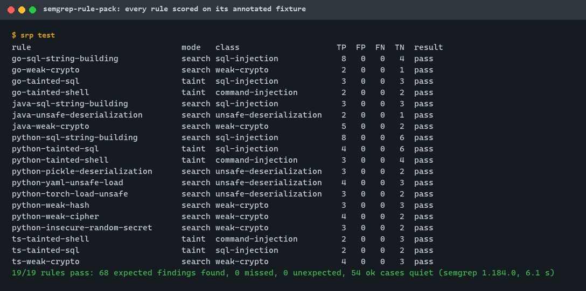
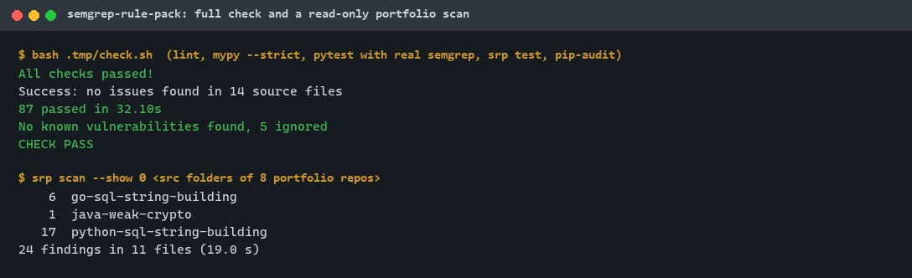
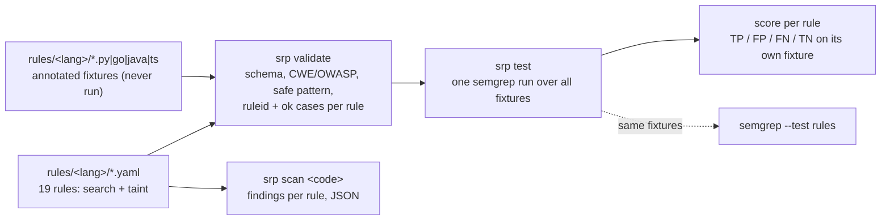
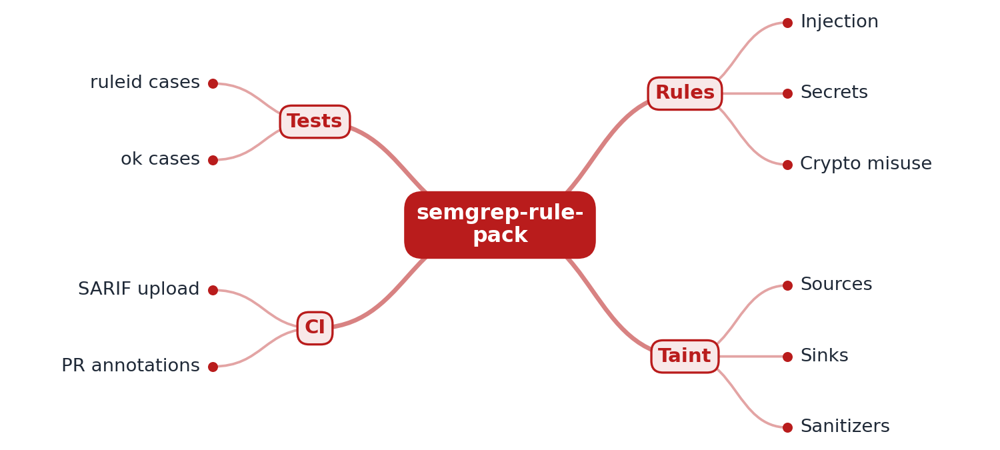

# semgrep-rule-pack

[](https://github.com/EquinoxWN/semgrep-rule-pack/actions/workflows/ci.yml)


> 19 Semgrep rules for SQL string building, unsafe deserialization and weak crypto in Python, Go, Java and TypeScript, with taint rules that follow request input to queries and shell commands unless it passes a sanitizer, and a harness that scores every rule against annotated fixtures.

Part of my **Cyber Security** list · YAML · Python

## Proof it works

Every rule is scored on its own fixture of annotated vulnerable and safe code: 68 expected findings
found, 0 missed, 0 unexpected, 54 safe cases quiet. Semgrep's own `semgrep --test rules` agrees
(19/19):



The full local check passes (ruff, mypy `--strict`, 87 tests including the real Semgrep, the rule
scores and `pip-audit`). A read-only scan of eight earlier portfolio repositories reports 24 sites,
triaged in [docs/results/m1.md](docs/results/m1.md); the scan also exposed a gap in the Go rule
(pgx's context-first `QueryRow`), now fixed:



## Architecture

**What M1 runs today:**



**Full roadmap (M1 to M3):**



## How it works

_Steps 1 and 2 are built and tested (M1); step 3 already holds for every rule (the fixtures gate CI), the rest is on the [roadmap](#roadmap)._

1. Rules target bug classes found in your other repos: SQL string building, unsafe deserialization, weak crypto.
2. Taint mode tracks data from sources (request input) to sinks (queries, shell) unless it passes a sanitizer.
3. Each rule ships test files with `ruleid:` and `ok:` annotations.
4. CI runs the tests and uploads SARIF to GitHub code scanning.
5. False-positive reports feed back into rule refinements.
6. Docs explain each vulnerability and the safe pattern to use instead.

### The rules

| Bug class | Search rules (broad, confidence MEDIUM/HIGH) | Taint rules (request input to sink, confidence HIGH) |
|---|---|---|
| SQL injection (CWE-89) | `python-`, `go-`, `java-sql-string-building`: SQL text built with f-strings, `%`, `.format`, `+`, `fmt.Sprintf`, `String.format` | `python-tainted-sql`, `go-tainted-sql`, `ts-tainted-sql`: Flask, Django, FastAPI `str` parameters, Go `*http.Request`, Express `req.*` into the SQL text argument only |
| Command injection (CWE-78) | - | `python-tainted-shell`, `go-tainted-shell`, `ts-tainted-shell`: into `os.system`, `shell=True`, `sh -c`, `exec()` |
| Unsafe deserialization (CWE-502) | `python-pickle-deserialization`, `python-yaml-unsafe-load`, `python-torch-load-unsafe` (`weights_only=False`, `allow_pickle=True`, `read_pickle`), `java-unsafe-deserialization` (`ObjectInputStream` without a filter, `XMLDecoder`) | - |
| Weak crypto (CWE-327/328/338) | `python-weak-hash` (unless `usedforsecurity=False`), `python-weak-cipher` (DES, 3DES, RC4, Blowfish, ECB), `python-insecure-random-secret`, `go-weak-crypto`, `java-weak-crypto` (MD5, SHA-1, bare `"AES"`, ECB), `ts-weak-crypto` (incl. `Math.random()` tokens) | - |

Sanitizers in the taint rules: `int()`, `float()`, `uuid.UUID()`, psycopg `sql.Identifier()`,
`shlex.quote()`, `shlex.join()`; `strconv.Atoi/Parse*`, `uuid.Parse`; `parseInt()`, `Number()`,
`parseFloat()`, `*.quote()`. Bound parameters and argument lists are safe because only the SQL text
or shell string is a sink. Why there are two tiers: [ADR 0002](docs/adr/0002-pattern-and-taint-tiers.md).

## Who it helps

- **Who:** developers and reviewers who maintain several Python, Go, Java or TypeScript services.
- **The problem:** the same injection, deserialization or weak-crypto mistake reappears in repo after repo, and untested rules drift (Semgrep even exits 0 when a rule fails to parse).
- **How to use it:** run `srp scan <path>` (or `semgrep --config rules <path>`) on a repository; block merges on the HIGH-confidence taint rules and use the broad search rules in review. To add a rule, put a fixture with `ruleid:` and `ok:` cases next to it; `srp validate` and `srp test` refuse rules without them.

## Tech stack

| Area | In M1 | Planned |
|---|---|---|
| Rules | Semgrep 1.184.0 rules in YAML, search and taint mode, Python, Go, Java, TypeScript | Rules refined from false-positive reports, upstream to Semgrep community rules |
| Harness | Python 3.11+ (`srp`): PyYAML safe loading, strict JSON parsing, per-rule scoring | Per-vulnerability docs |
| Test | pytest (87 tests), `semgrep --test`, generated taint matrix | - |
| CI | GitHub Actions: lint, tests, rule scores as `::notice`, pip-audit | SARIF upload to GitHub code scanning (M2) |

Language: **YAML · Python** (3.11+). Rules in [`rules/`](rules), harness in [`src/semgrep_rule_pack/`](src/semgrep_rule_pack).

## Run it

**Prerequisites:** Python 3.11+. `make` is optional: each target is a single command you can run
directly.

```bash
python -m venv .venv && source .venv/bin/activate   # Windows: .venv\Scripts\activate
make setup        # pip install -e ".[dev]" (installs semgrep==1.184.0)
make lint         # ruff, ruff format --check, mypy --strict
make test         # 87 tests; the 4 end-to-end tests run the real semgrep
make rules-test   # srp validate && srp test && semgrep --test rules
make audit        # pip-audit (see docs/results/m1.md for the 5 ignored advisories)

srp scan path/to/your/repo --json findings.json   # scan code with the pack
srp scan path/to/your/repo --fail-on-findings     # exit 1 when anything is found
semgrep --config rules path/to/your/repo          # or use the rules with plain semgrep
```

The harness reads no environment variables. For each scan it starts Semgrep with a temporary home
folder and sets `HOME`, `USERPROFILE`, `XDG_CONFIG_HOME`, `XDG_CACHE_HOME`,
`SEMGREP_SETTINGS_FILE`, `SEMGREP_LOG_FILE`, `SEMGREP_ENABLE_VERSION_CHECK=0` and
`SEMGREP_SEND_METRICS=off` for that child process only, plus `--metrics=off
--disable-version-check`: a scan makes no network calls. `--timeout` (default 600 s) bounds a scan.

## Tests and results

Full numbers, per-rule scores and the portfolio scan triage: [docs/results/m1.md](docs/results/m1.md).
The 10-rule quality check and 13 hand mutations (all killed): [docs/quality/2026-11-01.md](docs/quality/2026-11-01.md).

| Test file | Tests | What it proves |
|---|---|---|
| `test_annotations.py` | 11 | `ruleid:` / `ok:` annotations apply to the next line; malformed, stacked or dangling annotations are rejected with file and line |
| `test_catalog.py` | 31 | The shipped pack is valid (19 rules, 4 bug classes, 4 languages, 6 taint rules); 18 schema violations, missing `ruleid`/`ok` cases, unknown ids, bad fixtures, duplicates, bad YAML and oversized files are each reported |
| `test_runner.py` | 19 | Semgrep runs isolated (temporary home, metrics and version check off); crashes, timeouts, garbage output, a missing binary and errors reported inside Semgrep's JSON all raise |
| `test_score.py` | 8 | A missed line, a finding on an `ok` or unannotated line, and no findings all fail a rule; findings in other files do not count |
| `test_cli.py` | 14 | `srp validate`, `test` and `scan` exit codes, atomic JSON reports with UTC times, argument validation |
| `test_semgrep_e2e.py` | 4 | Real Semgrep: 19/19 rules score perfectly; `semgrep --test` agrees; taint fires on all 16 + 6 vulnerable handlers of a generated Python (48) and Go (12) matrix and on none of the sanitized or safe-API ones |

| Check | Result |
|---|---|
| Tests | **87 passed**, 0 failed, 0 skipped (Windows 11, Python 3.14.5, Semgrep 1.184.0) |
| Rule scores (`srp test`) | 19/19 rules: 68 expected findings found, 0 missed, 0 unexpected, 54 `ok` cases quiet |
| Taint matrix | 0 mismatches over 60 generated handlers (sources x sinks x vulnerable / sanitized / safe API) |
| Portfolio scan (8 repos, read-only) | 24 findings: 17 Python and 6 Go SQL-building sites with identifiers from code or config, 1 protocol-required SHA-1; 0 taint findings |
| Lint / types / audit | ruff and mypy `--strict` clean; `pip-audit`: no known vulnerabilities, 5 ignored advisories in packages Semgrep pins exactly |

## Roadmap

**M1** (≈8 h)
- [x] Write `docs/rfc/0001-design.md`: problem, goals, non-goals, chosen design
- [x] Rules target bug classes found in your other repos: SQL string building, unsafe deserialization, weak crypto.
- [x] Taint mode tracks data from sources (request input) to sinks (queries, shell) unless it passes a sanitizer.

**M2** (≈8 h)
- [ ] Each rule ships test files with `ruleid:` and `ok:` annotations. (Every M1 rule already has them, enforced by `srp validate`; M2 keeps this as the gate for new rules.)
- [ ] CI runs the tests and uploads SARIF to GitHub code scanning.

**M3** (≈9 h)
- [ ] False-positive reports feed back into rule refinements.
- [ ] Docs explain each vulnerability and the safe pattern to use instead.
- [ ] Publish the proof below with real numbers

## Proof

What this repo must show before it counts as done:

- Rules that caught real bugs in your own earlier code, with commit links.

| Result | Value |
|---|---|
| M3 proof above | Not shown yet (M3): the M1 portfolio scan found risky patterns but no exploitable bug; see [Tests and results](#tests-and-results). |

## Why it matters

- **Interview angle:** 'Scale application security across 100 teams'.
- **Upstream I'd like to contribute to:** Semgrep community rules.

## Design docs

- [RFC 0001: design](docs/rfc/0001-design.md)
- [ADR 0001: record architecture decisions](docs/adr/0001-record-architecture-decisions.md)
- [ADR 0002: a broad pattern rule and a precise taint rule per injection class](docs/adr/0002-pattern-and-taint-tiers.md)
- [M1 results](docs/results/m1.md)
- [Quality check, 2026-11-01](docs/quality/2026-11-01.md)

## Scope

This is a learning and portfolio project, not a hosted service. Everything runs locally. The fixture
files under `rules/` contain deliberately vulnerable code as test input for Semgrep; they are never
imported, compiled or run. Taint is intraprocedural (Semgrep OSS): input passed through a helper in
another function or file is not followed.

## Security and contributing

- Every GitHub Action is pinned to a commit SHA; workflows run read-only, without persisted credentials.
- Dependabot update pull requests are paused (`open-pull-requests-limit: 0`) so the repository keeps a single `main` branch; dependencies are updated by hand and checked by the CI audit.
- Rule files are parsed with `yaml.safe_load` and size limits; Semgrep runs as an argument list (no shell) with a timeout, and any error Semgrep reports fails the run.
- Report vulnerabilities privately: see [SECURITY.md](SECURITY.md). To contribute, see [CONTRIBUTING.md](CONTRIBUTING.md).

## License

MIT, see [LICENSE](LICENSE).
